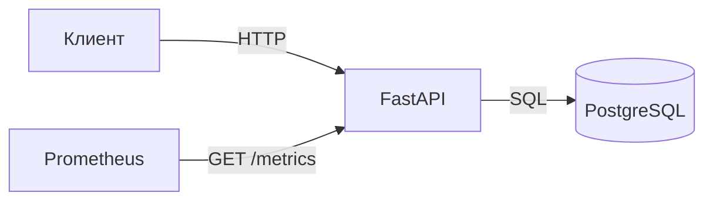

# portfolio-api

[](https://github.com/nikit0id/compose-app-cicd/actions/workflows/ci.yml)

FastAPI хранит задачи в PostgreSQL. Этот сервис используется в проектах доставки, мониторинга, резервного копирования и Kubernetes аккаунта nikit0id.



## Запуск за три команды

Потребуются Docker с Compose v2, Git и OpenSSL.

```bash
git clone https://github.com/nikit0id/portfolio-api && cd portfolio-api
./scripts/init-env
docker compose up -d --build --wait
```

Пайплайн [compose-app-cicd](https://github.com/nikit0id/compose-app-cicd) тестирует ревизию, указанную в его api-revision. Бейдж показывает результат для этой закреплённой версии.

Откройте http://localhost:8000/docs для работы с задачами. Проверка готовности доступна на /health. Команда `docker compose down` сохраняет данные в именованном томе.

## Что внутри

- `POST /tasks` создаёт задачу, `GET /tasks` возвращает до 100 задач, `PATCH /tasks/{id}` меняет статус.
- `GET /health` выполняет запрос к базе. `GET /metrics` отдаёт метрики Prometheus.
- Dockerfile собирает зависимости и запускает приложение с UID 10001.
- Интеграционные тесты используют PostgreSQL. Для локального прогона в отдельной тестовой БД задайте PGHOST, PGUSER, PGDATABASE, PGPASSWORD и при необходимости PGPORT. Затем выполните `python -m pip install -r requirements-dev.txt`, `ruff check .` и `python -m pytest -q`.

## Что я узнал

- Проверка HTTP-порта пропускает обрыв связи с базой. Запрос SELECT 1 позволяет вернуть 503 при потере соединения.
- Транзакция фиксируется при выходе из контекстного менеджера psycopg. Параметры SQL передаются отдельно от текста запроса.
- Том PostgreSQL переживает пересоздание приложения. Учётные данные из .env нужны и при повторном подключении к этому тому.

## Что бы сделал дальше

- Ввести миграции перед первым изменением схемы.
- Добавить постраничную выдачу для списков длиннее ста задач.
